

# Myna Macro Recorder & Auto Clicker

[English](../../README.md) · [Deutsch](README_de.md) · [Español](README_es.md) · [Français](README_fr.md) · [Italiano](README_it.md) · [Português (Brasil)](README_pt-BR.md) · [Polski](README_pl.md) · [Русский](README_ru.md) · [Українська](README_uk.md) · [Nederlands](README_nl.md) · [Čeština](README_cs.md) · [Svenska](README_sv.md) · [Română](README_ro.md) · [Türkçe](README_tr.md) · **简体中文** · [繁體中文](README_zh-TW.md) · [日本語](README_ja.md) · [한국어](README_ko.md) · [Tiếng Việt](README_vi.md) · [Bahasa Indonesia](README_id.md) · [ไทย](README_th.md) · [हिन्दी](README_hi.md) · [العربية](README_ar.md) · [فارسی](README_fa.md) · [עברית](README_he.md)

**一款你真正看得懂、也能编辑的 Windows 宏录制工具。**

录下你的操作，像编辑普通脚本一样修改，随时运行。
它通过图片在屏幕上查找目标，因此窗口移动后依然有效。

每个标签页展示三秒。静态图见下方。

---

## 实际效果

<b>Myna Recorder | AI Assistant</b>，YouTube 视频

## 功能概览

| | |
|---|---|
| **录制与回放** | 键盘和鼠标操作，保留原始时序。可按 0.25× 至 10× 的速度回放，也可循环播放。 |
| **以可读脚本编辑** | 同一个宏既可以是步骤列表，也可以是文本，两者双向同步。支持循环、条件、变量和函数，每一行旁边都有通俗易懂的说明。 |
| **图像锚点** | 等待屏幕上出现某张图片，或点击它。窗口移动、分辨率变化或换一台电脑，宏依然有效。 |
| **从屏幕读取文字** | 把订单号、总金额或文件名读入变量。两个读取器在你的电脑上运行；第三个则交给 AI 处理。 |
| **AI 助手** | 用日常语言描述宏，即可得到一段脚本。在你批准之前，内容不会进入编辑器。 |
| **屏幕监视** | 监视器会盯着屏幕上的某张图片，或向 AI 提问，可在宏运行期间使用，也可单独运行。它们可以弹出提示、通过 Telegram 或 Discord 发送消息、录制屏幕、运行已保存的脚本，或停止运行。 |
| **Telegram 与 Discord** | 接收来自监视器和宏的提醒，并可通过聊天进行控制：运行、暂停或停止 Recorder，还能获取截图。 |
| **屏幕视频与截图** | 在监视器事件前后录制屏幕，可从事件发生前几秒开始。可通过脚本或快捷键截图或录制视频，范围可以是整个屏幕、一个窗口、一个区域，或你拖出的方框。 |
| **颜色匹配** | 等待屏幕上出现某种颜色，或点击该颜色，并可按颜色、形状或颜色遮罩来匹配图片。 |
| **连拍裁剪** | 持续拍摄某个区域几秒钟，然后逐张翻看，按需裁剪任意数量的图片。 |
| **自动点击器** | 一次点击或一个按键，不断重复，最高每秒 1,000 次：可在光标处、指定点、方框内，或按一系列你通过点击录制的点进行，节奏与你点击时一致。支持抖动、随机分散、按住模式、次数或时间限制。 |
| **拟人化移动** | 指针会像真人的手一样移动到每个点击位置，宏和点击器中均适用。 |
| **Scheduler（调度器）** | 在你选择的日期和时间启动已保存的宏，可以只运行一次，也可以按固定间隔重复。Recorder 打开期间，按计划的运行会依次排队，逐个执行。 |
| **Timed Actions（定时操作）** | 按键、点击和等待按计时器重复执行，可与宏、点击器或监视器同时运行，也可单独运行。 |
| **窗口命令** | 通过窗口标题找到程序窗口，然后将其置于最前、等待其出现、移动、调整大小、最大化、最小化或关闭。 |
| **导出为程序** | 将宏导出为一个可在任何 Windows 电脑上运行的 .exe 文件，图像裁剪和本地文字读取器均已内置。 |
| **自定义快捷键** | 在任何程序中，按下组合键即可打开程序或网站，或播放宏。 |
| **剪贴板历史** | 保留你复制过的内容，固定常用项目，并通过快捷键粘贴。 |
| **Live view（实时视图）** | 一个面板汇总所有正在运行的内容：宏、监视器、计时器、快捷键、计划、剪贴板和日志。可按你的习惯排列，也可以把任意方框浮动到独立窗口中。 |
| **全局快捷键** | 在任何程序中使用：<kbd>F2</kbd> 录制，<kbd>F4</kbd> 运行，<kbd>F5</kbd> 暂停，<kbd>F6</kbd> 停止。运行键会启动当前打开的标签页对应的内容：宏、点击器、监视器或 Timed Actions。所有按键都可以更改。 |

## 界面截图

<table>
  <tr>
    <td align="center" width="50%">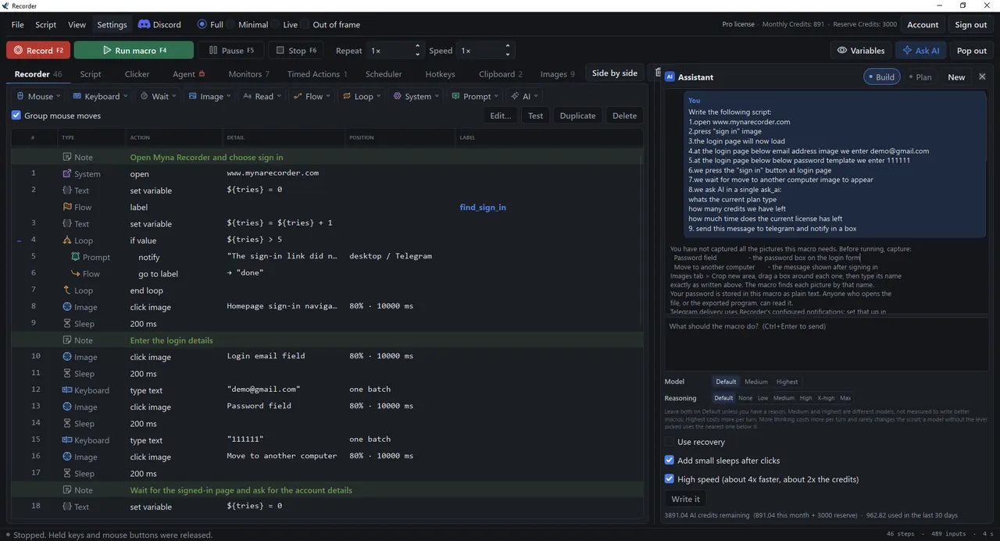 <b>Recorder</b>：每个步骤为一行，按区段分组</td>
    <td align="center" width="50%">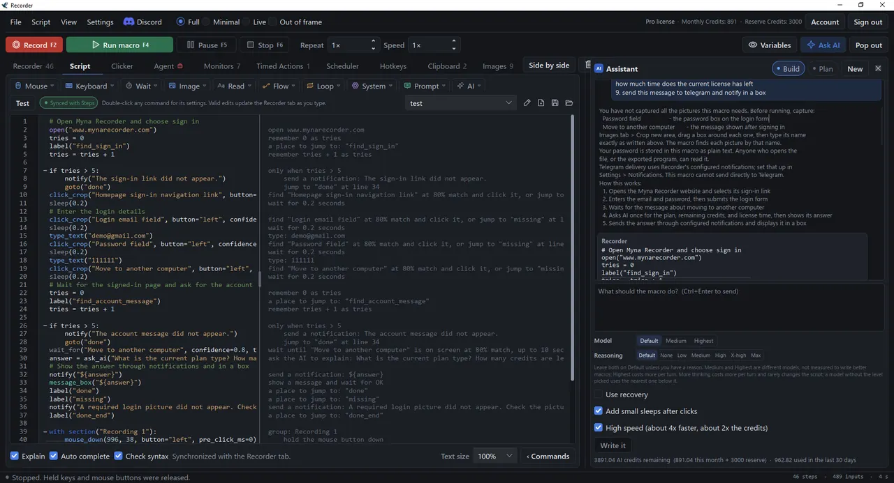 <b>Script</b>：同一个宏以文本形式呈现，旁边是 AI 助手</td>
  </tr>
  <tr>
    <td align="center" width="50%">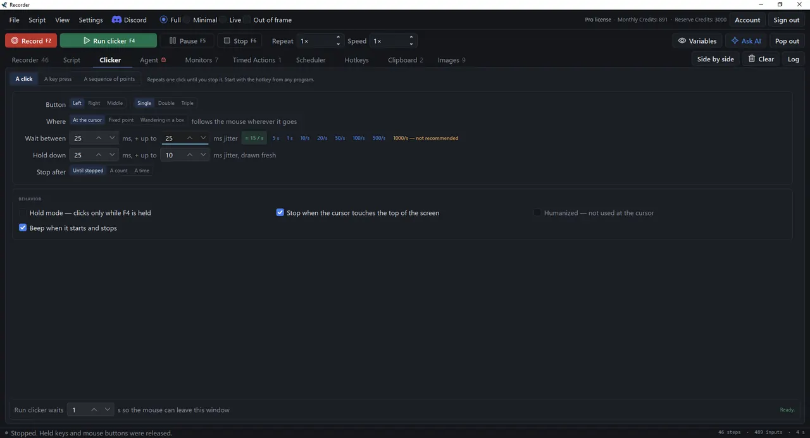 <b>自动点击器</b>：以设定速率单击，等待和按住时长可加入抖动</td>
    <td align="center" width="50%">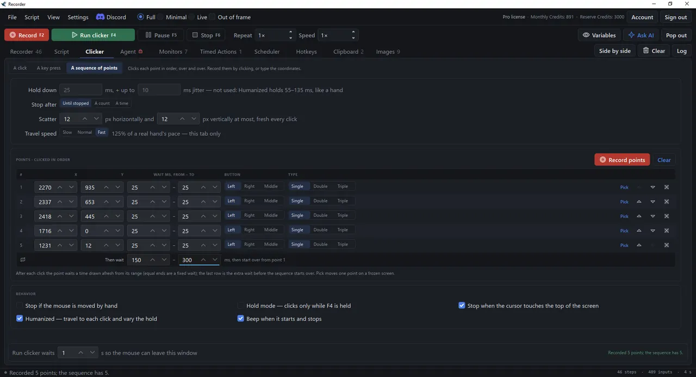 <b>点序列</b>：按顺序点击，每个点有各自的等待时间</td>
  </tr>
  <tr>
    <td align="center" width="50%">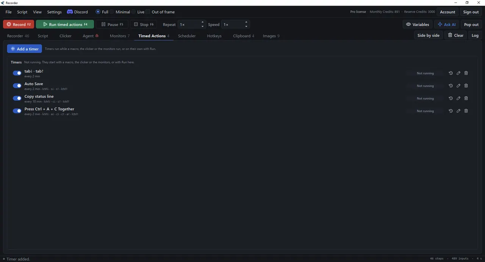 <b>Timed Actions</b>：按计时器重复的按键和点击</td>
    <td align="center" width="50%">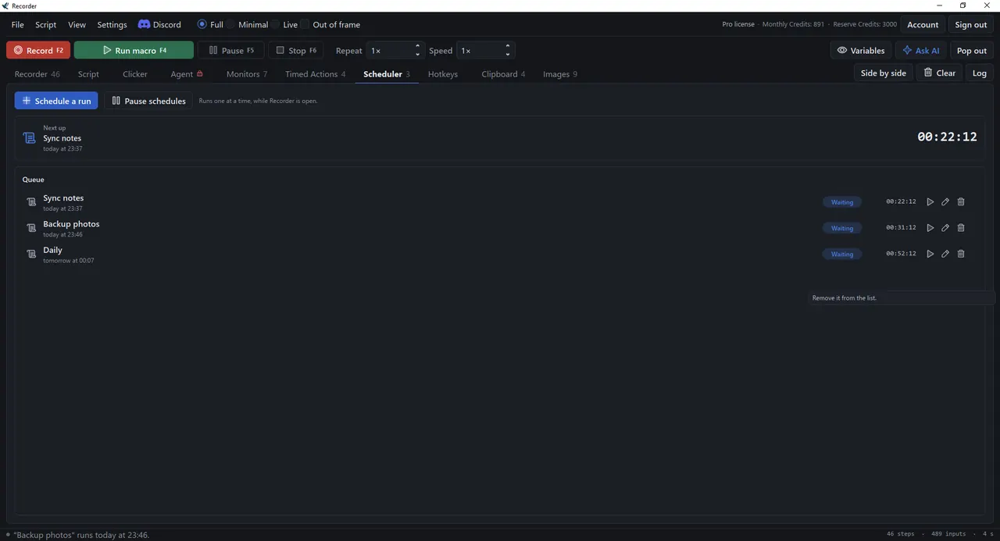 <b>Scheduler</b>：在设定的日期和时间，依次运行已保存的宏</td>
  </tr>
  <tr>
    <td align="center" width="50%">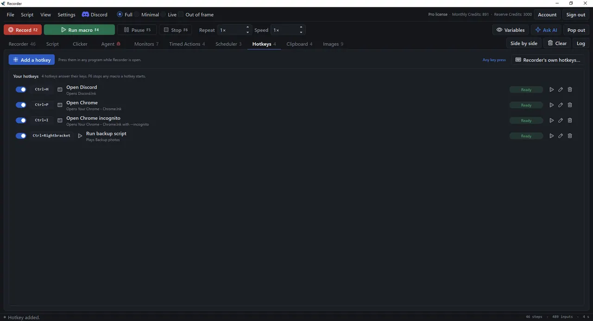 <b>Hotkeys</b>：你自己的组合键，在任何程序中都能用</td>
    <td align="center" width="50%">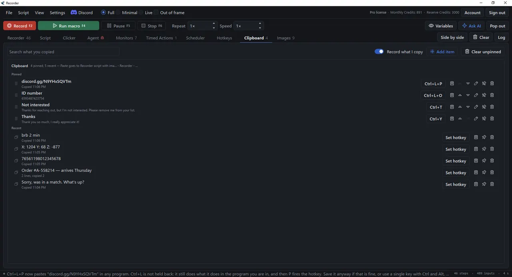 <b>Clipboard</b>：复制过的内容，可固定项目并用快捷键粘贴</td>
  </tr>
  <tr>
    <td align="center" colspan="2">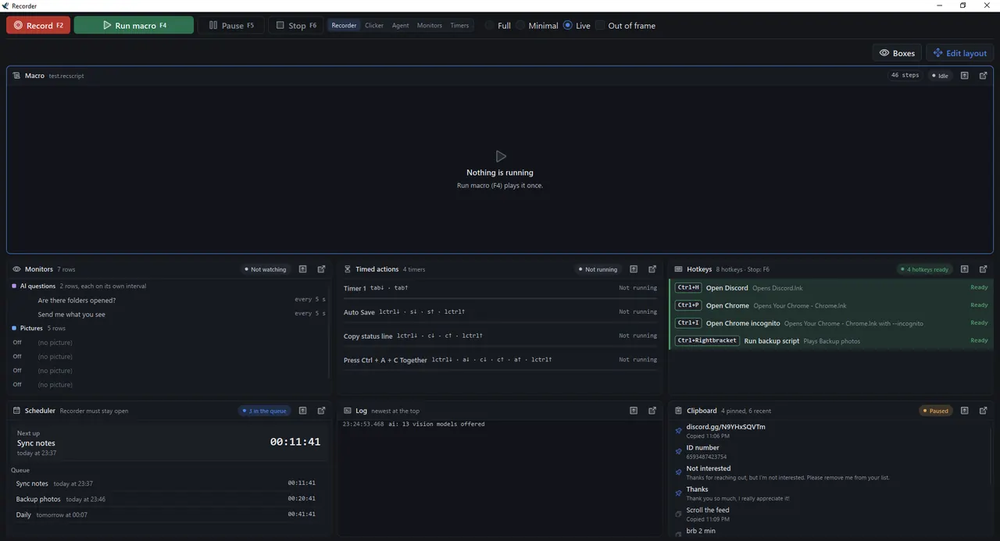 <b>Live view</b>：所有正在运行的内容，集中在一个面板上</td>
  </tr>
  <tr>
    <td align="center" colspan="2">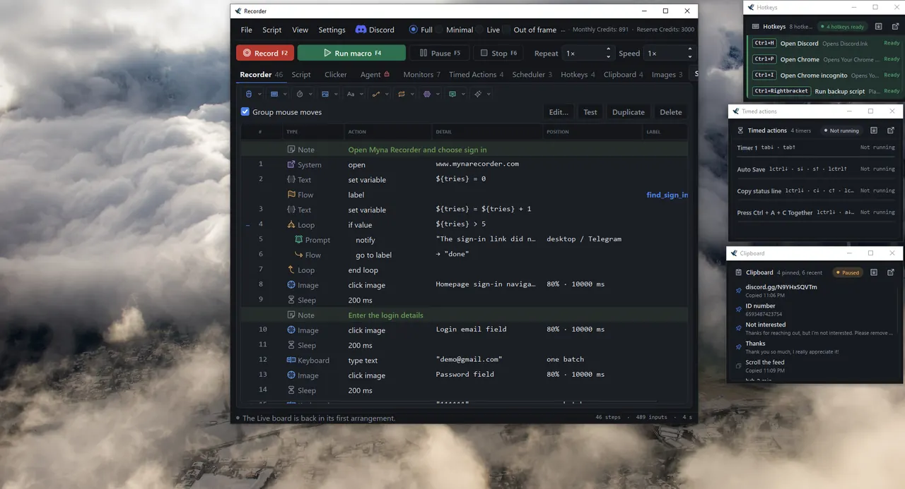 <b>浮动方框</b>：任意 Live 方框都可放入独立窗口，与你的工作并排显示</td>
  </tr>
  <tr>
    <td align="center" colspan="2">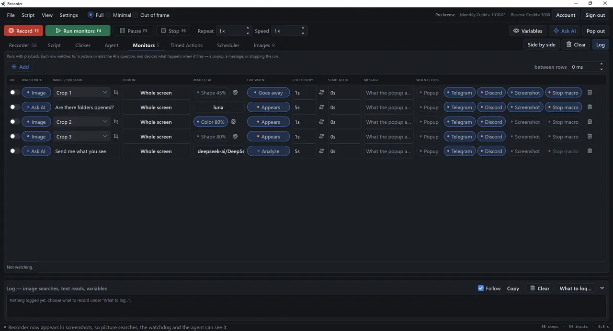 <b>Monitors</b>：根据图片或 AI 的回答触发，并向 Telegram 或 Discord 发送提醒的规则行</td>
  </tr>
</table>

## 开始使用

1. **下载并安装。** 从 [mynarecorder.com/download](https://mynarecorder.com/download) 获取安装程序，或获取独立的 `Myna Recorder.exe`，它无需安装即可在任何位置运行。当前版本为 2.1.0，于 2026 年 10 月 17 日发布。
2. **登录，或不使用账户继续。** 不使用账户，你也可以立即录制、编辑和回放。[免费账户](https://mynarecorder.com/register)可额外获得 7 天的付费功能试用，并保持登录状态。使用 **Continue with Google** 登录或创建你的 Myna 账户。
3. **录制一段操作，或直接描述它。** 按下录制并完成任务。使用 AI 助手时，输入你想要的内容，让它为你编写宏。
4. **运行它。** 随时按你选择的速度和重复次数回放。

如果首次运行时 Windows 显示“Windows 已保护你的电脑”，请选择 **更多信息**，然后点击 **仍要运行**。

## 套餐

录制、编辑、回放、图像锚点和自动点击器均免费，无需账户。其他内容请见 **[价格页面](https://mynarecorder.com/pricing)**。

## 系统要求

- Windows 10 或 Windows 11，64 位
- 支持 54 种语言：英语、德语、西班牙语、法语、意大利语、葡萄牙语（巴西）、波兰语、俄语、简体中文、日语、韩语、阿拉伯语、亚美尼亚语、阿塞拜疆语、白俄罗斯语、孟加拉语、波斯尼亚语、保加利亚语、缅甸语、繁体中文、克罗地亚语、捷克语、丹麦语、荷兰语、菲律宾语、芬兰语、格鲁吉亚语、希腊语、希伯来语、印地语、匈牙利语、印尼语、哈萨克语、高棉语、库尔德语、拉脱维亚语、立陶宛语、卢森堡语、马来语、挪威语、波斯语、罗马尼亚语、塞尔维亚语、僧伽罗语、斯洛伐克语、斯洛文尼亚语、瑞典语、泰语、土耳其语、乌克兰语、乌尔都语、维吾尔语、乌兹别克语和越南语。可随时在 Settings → General 中更改。
- 104 MB 的安装程序（`MynaRecorderSetup-2.1.0.exe`），或 103 MB 的独立 .exe，无需安装即可运行。两者均已数字签名。
- 登录和使用 AI 功能需要联网。录制、回放、图像锚点、本地文字读取器和自动点击器可离线使用。

## 文档与帮助

- **[用户手册](https://mynarecorder.com/manual)**：录制、回放、编辑、图像锚点、屏幕文字、助手、监视器、自动点击器、Scheduler、Timed Actions、导出和设置
- **[更新日志](https://mynarecorder.com/changelog)**：每个版本的更改内容
- **[Discord](https://discord.gg/N9YHxSQVTm)**：宏相关帮助、错误报告和公告
- **[问题追踪](https://github.com/myna-recorder/myna-macro-recorder/issues)**：错误报告和功能请求
- **support@mynarecorder.com**

Myna Macro Recorder & Auto Clicker（简称 Myna Recorder）可免费下载，并可在 Free 套餐中免费使用。它不是开源软件；本仓库用于存放问题追踪。下载请访问 [mynarecorder.com](https://mynarecorder.com/download)。
